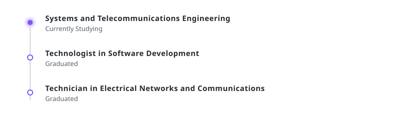

<!-- ═══════════════════════════════════════════════════════════════════ -->
<!--                            HEADER                                -->
<!-- ═══════════════════════════════════════════════════════════════════ -->

  

<!-- ═══════════════════════════════════════════════════════════════════ -->
<!--                          TECH STACK                              -->
<!-- ═══════════════════════════════════════════════════════════════════ -->

  

  

  &nbsp;
  &nbsp;
  
   
  &nbsp;
  
   
  &nbsp;
  &nbsp;
  &nbsp;
  
   
  &nbsp;
  &nbsp;
  

<!-- ═══════════════════════════════════════════════════════════════════ -->
<!--                          BACKGROUND                              -->
<!-- ═══════════════════════════════════════════════════════════════════ -->

  

  

  

 

  

